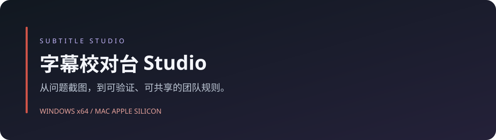
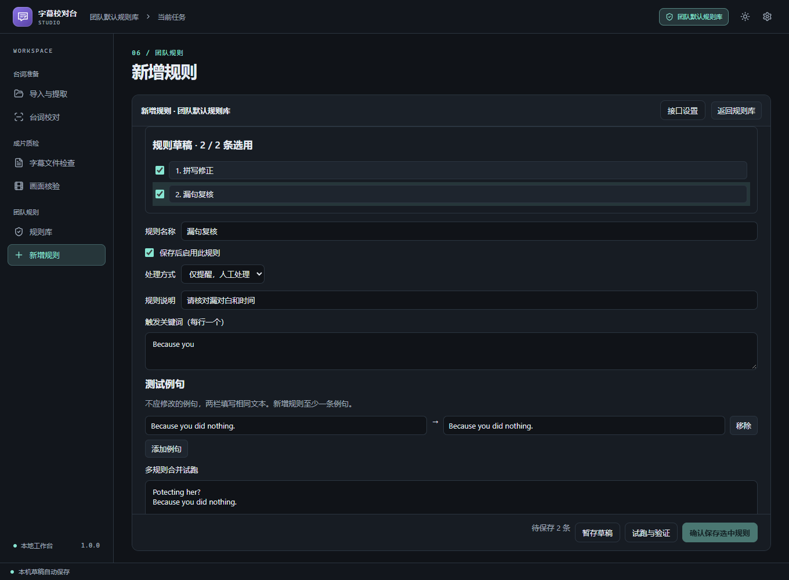
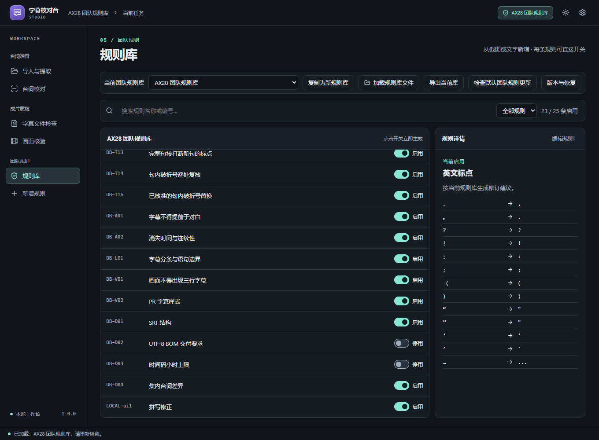

**台词校对 · 字幕检查 · 截图辅助写规则 · 团队规则库**

### 选择你的安装包

| Windows 安装版 | Mac M 系列安装版 |
| :---: | :---: |
| **[下载 EXE 安装包](https://github.com/sabermasterlc/subtitle-studio-releases/releases/download/v1.0.1/Windows-Setup.exe)** | **[下载 DMG 安装包](https://github.com/sabermasterlc/subtitle-studio-releases/releases/download/v1.0.1/Mac-M-Series.dmg)** |
| Windows 10 / 11 · 64 位 | macOS 14 及以上 · Apple Silicon |

[查看本版说明](https://github.com/sabermasterlc/subtitle-studio-releases/releases/tag/v1.0.1) · [反馈问题](https://github.com/sabermasterlc/subtitle-studio-releases/issues/new?template=bug_report.yml) · [安装与更新](INSTALL.md)

---

### 1.0.1 更新

- 修复英文台词夹带中文括号表演提示时漏纳入的问题；提取后请重新核对排除项。
- 校对页改为左侧原文、右侧修改后；拆条和合并保持来源关联，不同修正规则以不同颜色标记，悬浮可查看修改与规则。
- 关闭窗口可选择后台常驻或退出，并记住选择；通过系统托盘 / 菜单栏重新打开。
- 应用内置界面资源；本地提取和规则校对无需启动网页服务。截图辅助写规则和检查更新需要联网。

### 把遇到的问题，变成团队可复用的规则

- **截图或文字写规则**：在左侧「新增规则」描述问题，粘贴、拖入或选择截图，生成可编辑的规则草稿。
- **先试跑，再保存**：逐条查看例句结果；失败草稿可修改、暂存或请 AI 修复。通过的规则可以先保存。
- **一句台词，多条规则**：组合处理拼写、敏感词、标点等修订；上下文问题保留人工复核。
- **按工作习惯切换规则库**：复制、加载、导入、导出团队规则库；每条规则都可单独启用或停用。
- **校对后交接**：查看修订对比、核对专名与语境，再复制给 PR。

查看团队规则库

### 软件和规则，分别更新

**软件更新**：打开右上角「设置 → 更新与下载」，检查新版、下载安装包并校验。打开安装包前会暂存正在编辑的规则草稿；Windows 关闭正在运行的软件后覆盖安装，Mac 退出后替换「应用程序」中的旧版本。

**默认团队规则更新**：打开「规则库 → 检查默认团队规则更新」，预览后确认应用。软件会先备份，保留本机自定义规则及冲突值；其他自建规则库不随默认库自动变化。

[下载默认团队规则 JSON](rules/default-team.json) · 当前规则版本 **1.4.0**

### 个人接口与本机数据

截图辅助写规则需要个人 DeepSeek API：进入「新增规则 → 接口设置」，填写密钥并保存即可。密钥保存在系统凭据库。点击生成时，描述文字与所选截图会发送给对应接口，费用由个人接口账户承担。普通规则检测在本机运行。

### 安装说明

Windows 安装包尚未取得代码签名；Mac 安装包使用临时签名，尚未完成 Apple 公证，首次打开可能被系统拦截。请先阅读[安装说明](INSTALL.md)。Mac 已进行原生云端构建及安装副本运行检查，用户设备与真实剧集仍需测试。

这是**闭源软件的公开下载仓库**，只发布安装包、默认规则、更新信息和说明。应用源码不在本仓库；第三方组件的许可说明随安装包提供。
