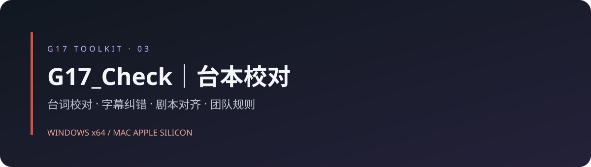
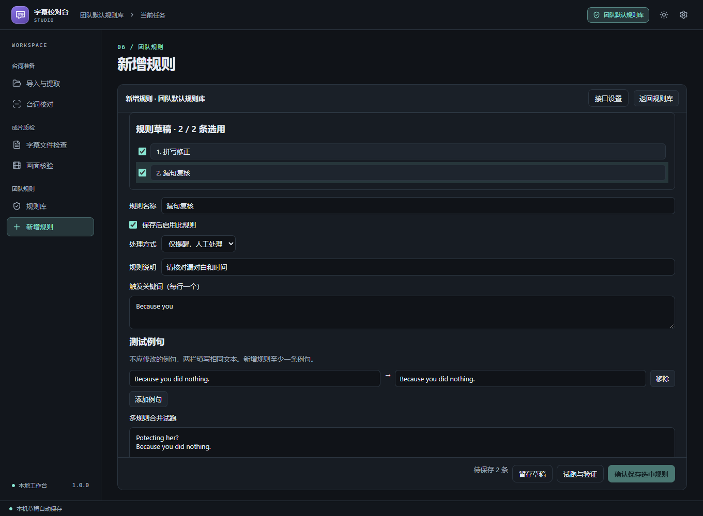

**G17 工具集 · 第三款工具**

台词校对 · 字幕纠错 · 剧本对齐 · 团队规则

| Windows 安装版 | Mac M 系列安装版 |
| :---: | :---: |
| **[下载 EXE 安装包](https://github.com/sabermasterlc/subtitle-studio-releases/releases/download/v1.0.11/G17_Check-Windows-Setup.exe)** | **[下载 DMG 安装包](https://github.com/sabermasterlc/subtitle-studio-releases/releases/download/v1.0.11/G17_Check-Mac-M-Series.dmg)** |
| Windows 10 / 11 · 64 位 | macOS 14 及以上 · Apple Silicon |

[1.0.11 版本说明](https://github.com/sabermasterlc/subtitle-studio-releases/releases/tag/v1.0.11) · [安装与更新](INSTALL.md) · [反馈问题](https://github.com/sabermasterlc/subtitle-studio-releases/issues/new?template=bug_report.yml)

### 1.0.11 更新

- 原「字幕校对台 Studio」更名为 **G17_Check｜台本校对**，加入 G17 工具集。
- 界面、窗口、托盘、安装包与应用名称统一；延续已有规则库、草稿和个人接口设置。
- 包含 1.0.10 的源文本自动校正：参照剧本修正 SRT 台词与断句，原文、源文本和结果并排检查，支持撤销及保存原文件。
- 台词校对与 SRT 校准共用当前团队规则库，保留逐条开关、规则编辑、导入导出与默认规则更新。

### 台词与字幕工作流

- **导入与提取**：从剧本整理台词，核对角色、语言和提取结果。
- **台词校对**：检查拼写、标点、敏感词与断句，查看修订及其规则依据。
- **SRT 校准**：导入字幕并提供源文本，检查和修正后保存；保留时间码、BOM 与换行格式。
- **团队规则库**：复制、加载、导入、导出规则库；每条规则可单独启停。
- **新增规则**：用截图或文字辅助生成规则草稿，试跑例句后再保存。

历史截图中的旧名称不代表当前版本名称。

### 软件和规则更新

在「设置 → 更新与下载」检查软件版本，下载时校验安装包。打开安装包前会暂存规则草稿。

默认团队规则在「规则库 → 检查默认团队规则更新」中预览并应用，保留本机自定义规则和冲突值。当前默认规则版本 **1.5.0**，与安装包内置规则一致；旧版请先升级至 1.0.11。

### 安装与兼容

Windows 可覆盖安装原 Studio 版。Mac 请退出旧版，将 `G17_Check.app` 拖入应用程序，确认新版可用后可移除旧的 `SubtitleStudio.app`；两者共用原有本机数据目录，使用时只运行一个版本。

Windows 安装包未取得代码签名；Mac 使用 ad hoc 签名，尚未完成 Apple 公证。首次打开及升级方式见[安装说明](INSTALL.md)。Mac M 系列安装包在原生 ARM 环境构建；不提供 Intel Mac 安装包。

### 个人接口与本机数据

普通规则校对在本机运行。截图辅助写规则需要个人 DeepSeek API，密钥保存在系统凭据库；生成时描述与所选截图发送给相应接口，费用由个人账户承担。

这是**闭源软件的公开下载仓库**，只发布安装包、默认规则、更新信息和说明。第三方组件许可说明随安装包提供。
